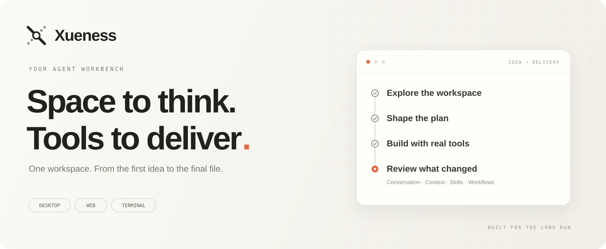
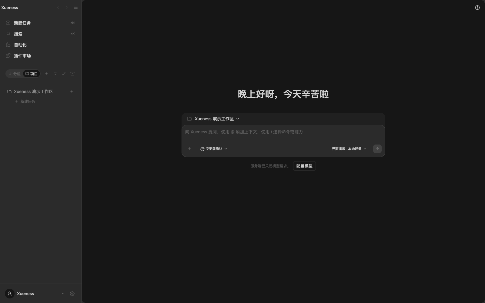
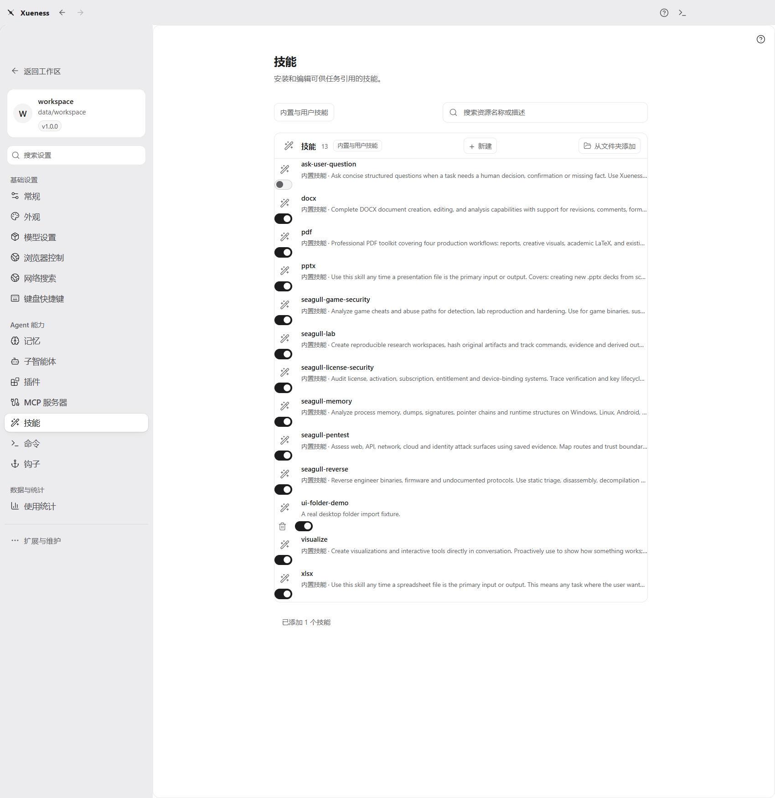

<p align="center">
  
</p>

<div align="center">

# Xueness 0.2.3

</div>

<p align="center"><b>Keep complex work moving.</b><br/>An agent workbench of your own: conversations, files, tools and workflows in one workspace.</p>

<p align="center">
  <a href="https://github.com/xuediner-source/xueness/actions/workflows/desktop-build.yml"></a>
  <a href="https://github.com/xuediner-source/xueness/releases"></a>
  <a href="LICENSE"></a>
  <a href="ts/README.md"></a>
</p>

<p align="center">
  <a href="README.md">简体中文</a>　·　<b>English</b>
</p>

<p align="center">
  <a href="https://github.com/xuediner-source/xueness/releases"><b>Download desktop</b></a>　·　
  <a href="#quick-start">Quick start</a>　·　
  <a href="#documentation">Documentation</a>　·　
  <a href="docs/optional-plugins-and-folder-skills.md">Plugins and skills</a>　·　
  <a href="https://github.com/xuediner-source/xueness/issues">Report an issue</a>
</p>

<p align="center"></p>

## What it is

Xueness is an open-source agent application for the workspace on your own machine, with three ways in: **desktop, browser and terminal**. Connect your own model and let it read the project, change files and run tools; progress, tool results and deliverables stay in one place. Every feature is provided by a plugin that you can switch on or off.

> The documentation is written in Chinese. The app's interface is available in Chinese and English.

## Highlights

<table>
<tr>
<td width="50%" valign="top">
<h4>Small models can do real work</h4>
<a href="docs/xueness-local-lightweight-mode.md">Lightweight mode</a> is built for local inference servers such as llama.cpp, Ollama and LM Studio: a stable prompt prefix the server can cache, long files paged by line, history trimmed to a budget, and constrained decoding for the JSON tool protocol.
</td>
<td width="50%" valign="top">
<h4>It remembers</h4>
<a href="docs/xueness-memory-ocean.md">Memory Ocean</a> keeps preferences, decisions and lessons across conversations, recalls them by task, and shows them as a star map. A memory dream rereads recent conversations and proposes merges, corrections and additions for you to confirm.
</td>
</tr>
<tr>
<td width="50%" valign="top">
<h4>Real tools</h4>
Files, shell, Git, terminal and browser work together inside the workspace, extended through MCP, skills, hooks and workflows. Permission modes, per-call approval and a <a href="docs/xueness-tool-judge.md">tool-call judge</a> decide what each step may do.
</td>
<td width="50%" valign="top">
<h4>Several agents, one board</h4>
A <a href="docs/xueness-swarm.md">swarm</a> hands separable work to a coordinator, workers and a verifier: each worker may change only the paths it owns, you approve the plan once, and the work is complete only when every acceptance criterion is graded as met.
</td>
</tr>
<tr>
<td width="50%" valign="top">
<h4>Run it your way</h4>
Connect an OpenAI-compatible or Anthropic endpoint and choose the model and reasoning level. Conversations, memories and settings stay on your machine, where you choose to keep them.
</td>
<td width="50%" valign="top">
<h4>See the work</h4>
Conversation history, task goals and context compaction keep long tasks traceable, with stop, resume, message forks and a queue. <a href="docs/xueness-tool-outcomes.md">Tool outcome statistics</a> show which calls really succeeded.
</td>
</tr>
</table>

## Quick start

### Desktop

Download from [Releases](https://github.com/xuediner-source/xueness/releases). Windows has an x64 installer and a portable build; Mac builds are separate for Apple Silicon and Intel. After the first start, add your own model connection in Settings. Release status, system permissions and install notes are in the [desktop guide](docs/xueness-desktop.md).

### Windows command line

One PowerShell command installs it, Node.js included:

```powershell
irm https://raw.githubusercontent.com/xuediner-source/xueness/main/install.ps1 | iex
```

Then run `xueness`; on first use run `xueness onboarding` to configure a model. Repeat the install command to update. See the [CLI install guide](docs/xueness-cli-install.md) for supported systems and data locations.

### From source

Requires Node.js 24.11 or newer. The repository ships a prebuilt web interface, and the backend runs TypeScript directly.

```sh
git clone https://github.com/xuediner-source/xueness.git
cd xueness
npm --prefix ts ci
node ts/apps/server/src/main.ts --port 8138
```

Open **http://127.0.0.1:8138** and configure a model before sending a task. In a terminal use `bin/xueness`; see the [terminal chat guide](docs/xueness-terminal-chat.md).

## Plugins and extensions

Skills, hooks, MCP connectors and collaborating agents are built in. The **subscription centre, returned-model monitor and WorkBuddy pool** are optional packages the marketplace downloads from this repository on demand; enable them in plugin management after installing.

| Entry | What you can do |
| :-- | :-- |
| Skills | Seven starter skills, each with its own switch; create new ones or add a folder with its scripts, references and attachments |
| MCP | Connect external tools, resources and services, and see connection state and request results |
| Workflows and collaboration | Split tasks, configure hooks, and follow progress and results |
| Subscription centre · optional | Import accounts or sign-in credentials you are authorised to use, and use their models and quota |
| Returned-model monitor · optional | Passively compare the requested model with the one a response reports; sends no probe requests |
| WorkBuddy pool · optional | Add your own account credentials, see the pool's state and use its models |

<p align="center"></p>

Installing, removing, folder import scope and verification are covered in the [plugins and skills guide](docs/optional-plugins-and-folder-skills.md).

## Documentation

The guides are written in Chinese.

| Topic | Guides |
| :-- | :-- |
| Install and run | [Desktop](docs/xueness-desktop.md) · [CLI install](docs/xueness-cli-install.md) · [Terminal chat](docs/xueness-terminal-chat.md) · [Deployment](docs/deploy.md) |
| Models and runtime | [Lightweight mode](docs/xueness-local-lightweight-mode.md) · [Permission modes](docs/xueness-permission-modes.md) · [Reliability and updates](docs/xueness-reliability-and-updates.md) |
| Conversations and context | [Conversation experience](docs/xueness-conversation-experience.md) · [Goals and compaction](docs/session-goals-and-context-compaction.md) · [Message queue](docs/xueness-message-queue.md) · [Resume and cancel](docs/sessions-resume-cancel.md) |
| Memory and collaboration | [Memory Ocean](docs/xueness-memory-ocean.md) · [Swarm](docs/xueness-swarm.md) · [Sub-agent coordination](docs/xueness-subagent-coordination.md) |
| Tools | [Tool-call judge](docs/xueness-tool-judge.md) · [Tool outcomes](docs/xueness-tool-outcomes.md) · [Network tools](docs/xueness-network-tools.md) · [Browser profiles](docs/xueness-browser-profiles.md) |
| Plugin development | [Plugin architecture](docs/xueness-plugin-architecture.md) · [Plugin SDK](docs/xueness-plugin-sdk.md) · [Plugins and skills](docs/optional-plugins-and-folder-skills.md) |
| Interface | [UI design](docs/xueness-ui-design.md) · [Settings and workspaces](docs/xueness-settings-workspaces.md) · [Start interface](docs/xueness-start-interface.md) |

## Development

```sh
# Backend: file size, plugin ownership, version and type checks
npm --prefix ts run check

# Frontend: install, type-check and build
npm --prefix webapp ci
npm --prefix webapp run typecheck
npm --prefix webapp run build
```

The frontend build also produces the optional plugin packages and removes their code and styles from the core bundle. The desktop build bundles its own Node runtime and must run on the target system and architecture; commands are in the [desktop guide](docs/xueness-desktop.md).

| Directory | Contents |
| :-- | :-- |
| [`ts/apps`](ts/apps) | HTTP, CLI and desktop backend hosts |
| [`ts/packages`](ts/packages) | Agent, protocol, permissions, storage and plugin infrastructure |
| [`ts/plugins`](ts/plugins) | Plugins by feature, with their manifests |
| [`webapp`](webapp) | The React workbench and plugin interfaces |
| [`desktop`](desktop) | Electron host, native integration and installer builds |
| [`marketplace/packages`](marketplace/packages) | Official optional plugin packages, named by content digest |

Unit tests, test CI, acceptance and load-test material are kept in a separate [private validation repository](https://github.com/xuediner-source/xueness-private-tests); this repository holds only what is needed to run, build and use the application.

## Contributing

Issues and pull requests are welcome. Every new feature must belong to a plugin; the process and conventions are in the [contributing guide](CONTRIBUTING.md).

## License

[Apache-2.0](LICENSE). Third-party components and their licences are listed in [NOTICE](NOTICE.md).

---

<p align="center">Your own model, your own tasks.</p>
