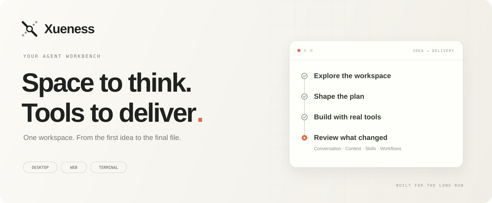
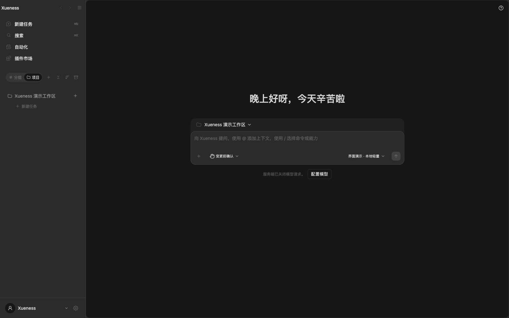
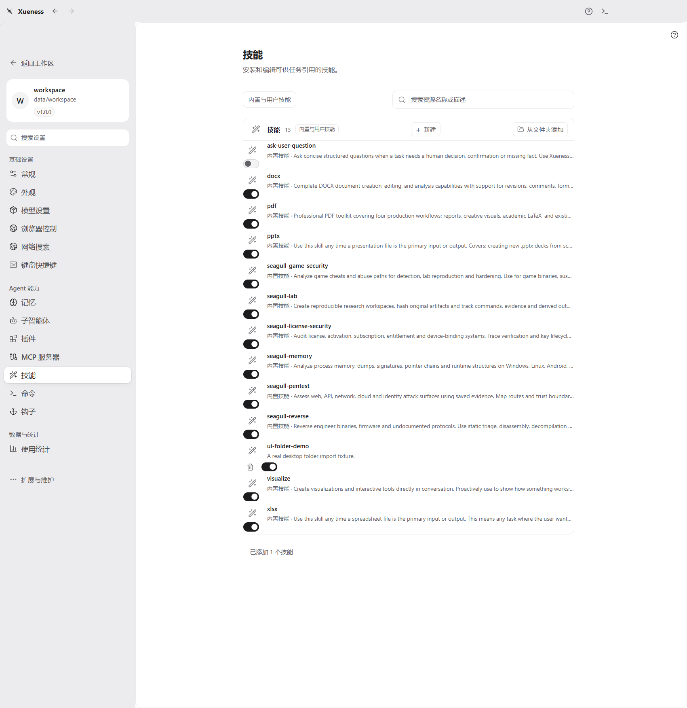

<p align="center">
  
</p>

<h3 align="center">让复杂任务，持续向前。</h3>
<p align="center">一个属于你的 Agent 工作台。把对话、文件、工具与工作流，放进同一个工作空间。</p>

<p align="center">
  <a href="https://github.com/xuediner-source/xueness/actions/workflows/desktop-build.yml"></a>
  <a href="LICENSE"></a>
  <a href="ts/README.md"></a>
</p>

<p align="center">
  <a href="https://github.com/xuediner-source/xueness/releases"><b>桌面端下载</b></a>　·　
  <a href="#快速开始">快速开始</a>　·　
  <a href="docs/xueness-desktop.md">使用文档</a>　·　
  <a href="docs/optional-plugins-and-folder-skills.md">插件与技能</a>　·　
  <a href="https://github.com/xuediner-source/xueness/issues">反馈问题</a>
</p>

---

### 一个工作台，贯穿任务始终

Xueness 是面向本机工作空间的开源 Agent 应用，提供 **桌面、浏览器和终端**三个入口。选择自己的模型连接，让模型读项目、改文件、运行工具；在同一处查看任务进展、工具结果与交付内容。

<table>
<tr>
<td width="33%" valign="top"><h4>01 / 保持上下文</h4>会话历史、任务目标、上下文压缩与项目记忆，让持续进行的工作有迹可循。支持停止、恢复和消息分叉。</td>
<td width="33%" valign="top"><h4>02 / 连接真实工具</h4>文件、Shell、Git、终端与浏览器在工作区内协作。通过 MCP、技能、钩子和工作流扩展任务能力。</td>
<td width="33%" valign="top"><h4>03 / 按你的方式运行</h4>连接 OpenAI 兼容接口或 Anthropic 接口，选择模型与推理档位，管理权限、插件开关和本机数据位置。</td>
</tr>
</table>

<p align="center"></p>

### 快速开始

**桌面使用**：前往 [Releases](https://github.com/xuediner-source/xueness/releases) 选择已发布的安装资产。Windows 提供 x64 安装与便携形式；Mac 构建区分 Apple Silicon 和 Intel。发行状态、系统授权和安装说明见[桌面端指南](docs/xueness-desktop.md)。首次启动后，在设置中添加自己的模型连接。

**源码运行**：需要 Node.js 24.11 或更新版本。仓库附带预构建 Web 界面，后端直接运行 TypeScript。

```sh
git clone https://github.com/xuediner-source/xueness.git
cd xueness
npm --prefix ts ci
node ts/apps/server/src/main.ts --port 8138
```

打开 **http://127.0.0.1:8138**，完成模型配置后即可开始任务。终端用户可使用 `bin/xueness`，详见[终端聊天指南](docs/xueness-terminal-chat.md)。

### 能力按需扩展

技能、钩子、MCP 连接器与协作代理属于内置能力，无需在市场重复安装。**订阅中心、返回模型监测、WorkBuddy 号池**由扩展市场从本仓库按需下载，安装后再到插件管理启用。

| 入口 | 你可以做什么 |
| :-- | :-- |
| 技能 | 七项初始技能可见并可逐项启用；支持新建和从文件夹添加，保留脚本、参考资料和附件 |
| MCP | 连接外部工具、资源与服务，查看连接状态和请求结果 |
| 工作流与协作 | 拆分任务、配置钩子，查看执行进度与结果 |
| 订阅中心 · 可选 | 导入自己授权的账号或登录凭证，使用其模型与可用额度 |
| 返回模型监测 · 可选 | 被动比较请求型号与响应中报告的型号，不额外发送探测请求 |
| WorkBuddy 号池 · 可选 | 添加自备账号认证、查看号池状态并使用可用模型 |

安装、移除、文件夹导入范围与验证方式见[插件与技能指南](docs/optional-plugins-and-folder-skills.md)。

<p align="center"></p>

### 开发与验证

```sh
# 后端：类型、插件归属、文件规模与完整测试
npm --prefix ts run check

# 前端：安装依赖、测试并构建
npm --prefix webapp ci
npm --prefix webapp run typecheck
npm --prefix webapp run build
```

前端构建同时生成三个独立插件包，并从核心界面产物中移除对应代码与样式。桌面构建包含独立 Node 运行时；在目标系统与架构上构建，命令见[桌面开发指南](docs/xueness-desktop.md)。

| 目录 | 内容 |
| :-- | :-- |
| [`ts/apps`](ts/apps) | HTTP、CLI 与桌面后端宿主 |
| [`ts/packages`](ts/packages) | Agent、协议、权限、存储与插件基础设施 |
| [`ts/plugins`](ts/plugins) | 按功能划分的插件实现及声明 |
| [`webapp`](webapp) | React 工作台与插件界面 |
| [`desktop`](desktop) | Electron 宿主、原生集成与安装构建 |
| [`marketplace/packages`](marketplace/packages) | 按内容摘要命名的官方可选插件包 |

单元测试、测试 CI、验收、审查和压测材料由[私有验证库](https://github.com/xuediner-source/xueness-private-tests)独立维护。公开源码保留应用与构建资源；功能归属见[插件架构](docs/xueness-plugin-architecture.md)，开发流程见[贡献指南](CONTRIBUTING.md)。

<details>
<summary>历史交接与实现范围</summary>

历史交付与审查记录已迁入私有验证库。Xueness 的使用和构建以本仓库当前说明为准。

</details>

---

<p align="center">用自己的模型，处理自己的任务。<br/><sub>Apache-2.0 · 第三方组件与授权见 <a href="NOTICE.md">NOTICE</a></sub></p>
