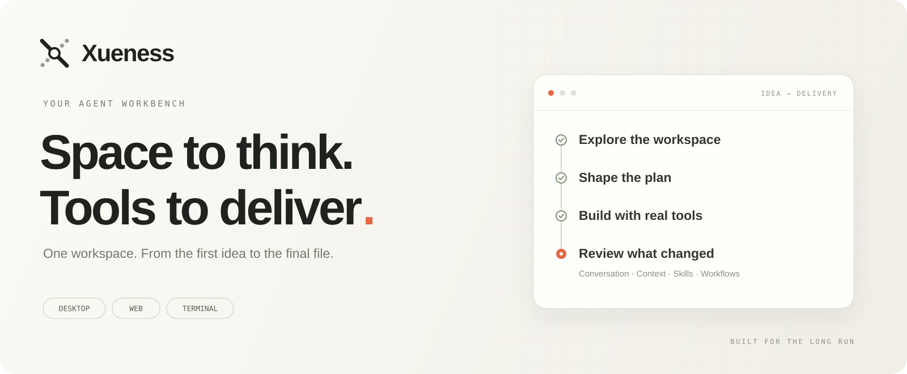
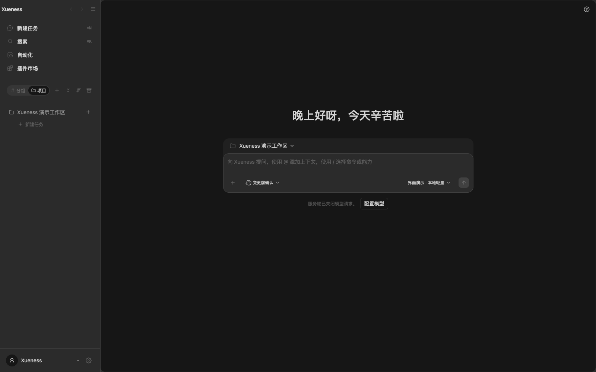
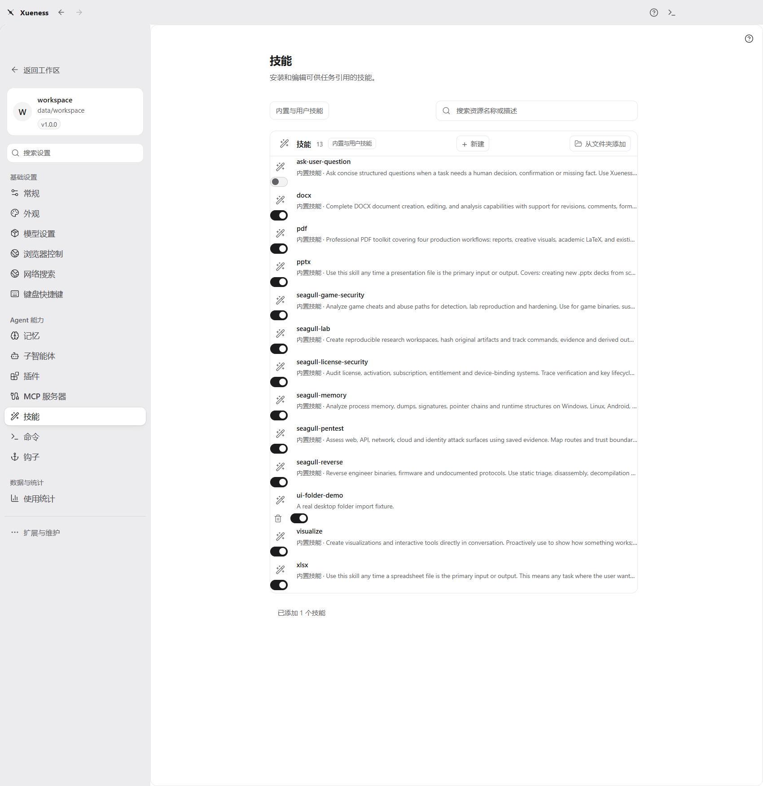

<p align="center">
  
</p>

<h1 align="center">Xueness</h1>

<p align="center"><b>让复杂任务，持续向前。</b><br/>一个属于你的 Agent 工作台：对话、文件、工具与工作流，放进同一个工作空间。</p>

<p align="center">
  <a href="https://github.com/xuediner-source/xueness/actions/workflows/desktop-build.yml"></a>
  <a href="https://github.com/xuediner-source/xueness/releases"></a>
  <a href="LICENSE"></a>
  <a href="ts/README.md"></a>
</p>

<p align="center">
  <b>简体中文</b>　·　<a href="README.en.md">English</a>
</p>

<p align="center">
  <a href="https://github.com/xuediner-source/xueness/releases"><b>下载桌面端</b></a>　·　
  <a href="#快速开始">快速开始</a>　·　
  <a href="#文档">文档</a>　·　
  <a href="docs/optional-plugins-and-folder-skills.md">插件与技能</a>　·　
  <a href="https://github.com/xuediner-source/xueness/issues">反馈问题</a>
</p>

<p align="center"></p>

## 这是什么

Xueness 是面向本机工作空间的开源 Agent 应用，提供**桌面、浏览器和终端**三个入口。接上你自己的模型，让它读项目、改文件、运行工具；任务进展、工具结果和交付内容都在同一处查看。每一项功能都由插件提供，可以逐个开关。

## 特点

<table>
<tr>
<td width="50%" valign="top">
<h4>小模型也能干活</h4>
<a href="docs/xueness-local-lightweight-mode.md">本地轻量模式</a>为 llama.cpp、Ollama、LM Studio 这类本机推理服务而做：稳定的提示前缀让服务复用缓存，长文件按行分页，历史按预算裁剪，JSON 工具协议可用约束解码。
</td>
<td width="50%" valign="top">
<h4>记得住</h4>
<a href="docs/xueness-memory-ocean.md">记忆之海</a>保存跨会话的偏好、决定和教训，按任务召回，并以星图呈现。「记忆整理」重读最近的对话，提出合并、更正和补充，由你确认后生效。
</td>
</tr>
<tr>
<td width="50%" valign="top">
<h4>连接真实工具</h4>
文件、Shell、Git、终端与浏览器在工作区内协作，通过 MCP、技能、钩子和工作流扩展。权限模式、逐项审批和<a href="docs/xueness-tool-judge.md">工具调用判定</a>决定每一步能做什么。
</td>
<td width="50%" valign="top">
<h4>多个代理，一块看板</h4>
<a href="docs/xueness-swarm.md">蜂群</a>把能拆开的大任务交给协调者、工作者和验证者：每个工作者只能改自己的路径，计划经你批准一次，验收标准逐条评定后才算完成。
</td>
</tr>
<tr>
<td width="50%" valign="top">
<h4>按你的方式运行</h4>
连接 OpenAI 兼容接口或 Anthropic 接口，选择模型与推理档位。会话、记忆和配置都留在本机，数据位置由你决定。
</td>
<td width="50%" valign="top">
<h4>看得见过程</h4>
会话历史、任务目标与上下文压缩让长任务有迹可循；支持停止、恢复、消息分叉和排队；<a href="docs/xueness-tool-outcomes.md">工具结果统计</a>告诉你哪些调用真的成功了。
</td>
</tr>
</table>

## 快速开始

### 桌面端

前往 [Releases](https://github.com/xuediner-source/xueness/releases) 下载。Windows 提供 x64 安装与便携形式；Mac 构建区分 Apple Silicon 和 Intel。首次启动后，在设置中添加自己的模型连接。发行状态、系统授权和安装说明见[桌面端指南](docs/xueness-desktop.md)。

### Windows 命令行

PowerShell 一条命令安装，自带 Node.js：

```powershell
irm https://raw.githubusercontent.com/xuediner-source/xueness/main/install.ps1 | iex
```

安装后运行 `xueness`；首次使用先运行 `xueness onboarding` 配置模型。更新时重复安装命令。支持范围和数据位置见 [CLI 安装指南](docs/xueness-cli-install.md)。

### 从源码运行

需要 Node.js 24.11 或更新版本。仓库附带预构建的 Web 界面，后端直接运行 TypeScript。

```sh
git clone https://github.com/xuediner-source/xueness.git
cd xueness
npm --prefix ts ci
node ts/apps/server/src/main.ts --port 8138
```

打开 **http://127.0.0.1:8138**，完成模型配置后即可开始任务。终端里使用 `bin/xueness`，见[终端聊天指南](docs/xueness-terminal-chat.md)。

## 插件与扩展

技能、钩子、MCP 连接器与协作代理是内置能力，无需另外安装。**订阅中心、返回模型监测、WorkBuddy 号池和酒馆**不随 Xueness 预装：在扩展市场里选择后，才从官方插件仓库 [xueness-marketplace](https://github.com/xuediner-source/xueness-marketplace) 下载，安装后到插件管理中启用。

| 入口 | 你可以做什么 |
| :-- | :-- |
| 技能 | 七项初始技能可逐项启用；支持新建和从文件夹添加，保留脚本、参考资料和附件 |
| MCP | 连接外部工具、资源与服务，查看连接状态和请求结果 |
| 工作流与协作 | 拆分任务、配置钩子，查看执行进度与结果 |
| 订阅中心 · 可选 | 导入自己授权的账号或登录凭证，使用其模型与可用额度 |
| 返回模型监测 · 可选 | 被动比较请求型号与响应中报告的型号，不额外发送探测请求 |
| WorkBuddy 号池 · 可选 | 添加自备账号认证、查看号池状态并使用可用模型 |
| 酒馆 · 可选 | SillyTavern 兼容的角色卡、世界书、预设与人设，在酒馆面板里开始并继续角色扮演对话 |

<p align="center"></p>

安装、移除、文件夹导入范围与验证方式见[插件与技能指南](docs/optional-plugins-and-folder-skills.md)。

## 文档

| 主题 | 文档 |
| :-- | :-- |
| 安装与运行 | [桌面端](docs/xueness-desktop.md) · [CLI 安装](docs/xueness-cli-install.md) · [终端聊天](docs/xueness-terminal-chat.md) · [部署](docs/deploy.md) |
| 模型与运行方式 | [本地轻量模式](docs/xueness-local-lightweight-mode.md) · [权限模式](docs/xueness-permission-modes.md) · [可靠性与更新](docs/xueness-reliability-and-updates.md) |
| 会话与上下文 | [对话体验](docs/xueness-conversation-experience.md) · [目标与上下文压缩](docs/session-goals-and-context-compaction.md) · [消息队列](docs/xueness-message-queue.md) · [恢复与取消](docs/sessions-resume-cancel.md) |
| 记忆与协作 | [记忆之海](docs/xueness-memory-ocean.md) · [蜂群](docs/xueness-swarm.md) · [子代理协作](docs/xueness-subagent-coordination.md) |
| 工具 | [工具调用判定](docs/xueness-tool-judge.md) · [工具结果统计](docs/xueness-tool-outcomes.md) · [网络工具](docs/xueness-network-tools.md) · [浏览器配置](docs/xueness-browser-profiles.md) |
| 插件开发 | [插件架构](docs/xueness-plugin-architecture.md) · [插件 SDK](docs/xueness-plugin-sdk.md) · [插件与技能](docs/optional-plugins-and-folder-skills.md) |
| 界面 | [界面设计](docs/xueness-ui-design.md) · [设置与工作区](docs/xueness-settings-workspaces.md) · [起始界面](docs/xueness-start-interface.md) |

## 开发

```sh
# 后端：文件规模、插件归属、版本与类型检查
npm --prefix ts run check

# 前端：安装依赖、类型检查并构建
npm --prefix webapp ci
npm --prefix webapp run typecheck
npm --prefix webapp run build
```

前端构建同时生成独立的可选插件包，并从核心界面产物中移除对应的代码与样式。桌面构建包含独立的 Node 运行时，需在目标系统与架构上进行，命令见[桌面端指南](docs/xueness-desktop.md)。

| 目录 | 内容 |
| :-- | :-- |
| [`ts/apps`](ts/apps) | HTTP、CLI 与桌面后端宿主 |
| [`ts/packages`](ts/packages) | Agent、协议、权限、存储与插件基础设施 |
| [`ts/plugins`](ts/plugins) | 按功能划分的插件实现及声明 |
| [`webapp`](webapp) | React 工作台与插件界面 |
| [`desktop`](desktop) | Electron 宿主、原生集成与安装构建 |

单元测试、测试 CI、验收和压测材料由[私有验证库](https://github.com/xuediner-source/xueness-private-tests)独立维护；公开仓库只保留应用运行、构建和使用所需的文件。

## 参与贡献

欢迎提交 Issue 和 Pull Request。新功能必须归属到一个插件，流程与约定见[贡献指南](CONTRIBUTING.md)。

## 许可

[Apache-2.0](LICENSE)。第三方组件与授权见 [NOTICE](NOTICE.md)。

---

<p align="center">用自己的模型，处理自己的任务。</p>
